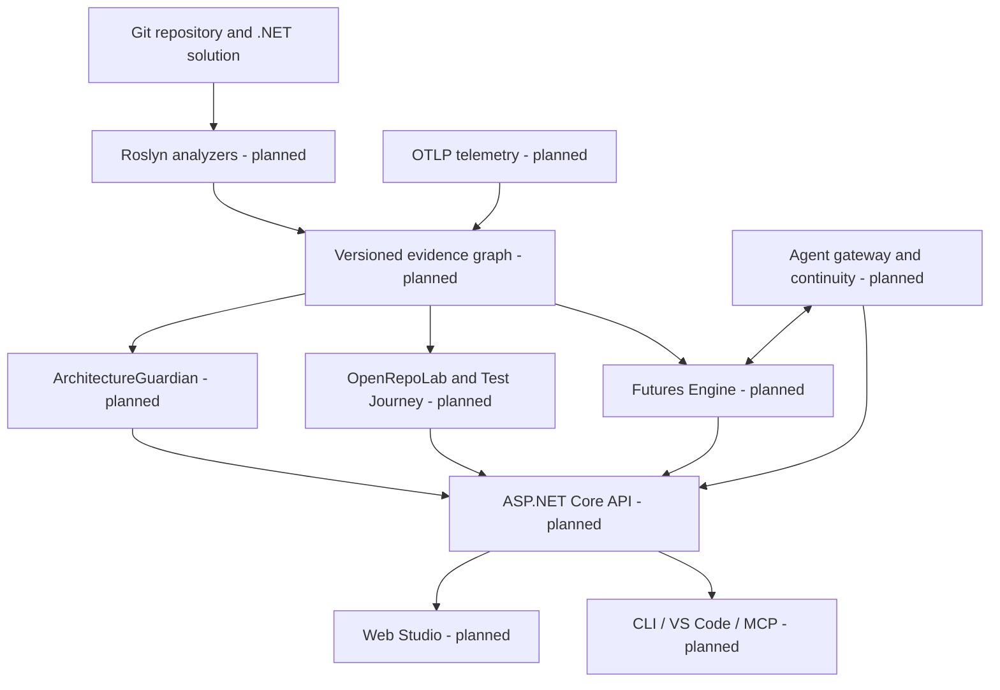

# ArchPulse

**Living Software Engineering & Architectural Futures Platform** · **Status: engineering foundation / under active development** · **License: Apache-2.0**

[العربية](README.ar.md) · [Contribute](CONTRIBUTING.md) · [Governance](GOVERNANCE.md) · [Architecture](docs/architecture/README.md) · [Roadmap](ROADMAP.md) · [Agent handoff](AGENTS.md)

> **Experimental partial platform, not a production-ready product.** The repository now contains tested local-only C# graph indexing, an immutable graph store, a read-only ASP.NET API, a React source-graph prototype, MCP Apps experiments, static test links and partial Test Journey receipts. These do **not** establish authenticated public access, runtime traces, feature completeness, or full S00–S33 acceptance. Do not publish green badges or capability-completeness claims without exact-revision CI and acceptance evidence.

## Why ArchPulse?

Repository code, intended design, runtime traces, test results, and AI-agent decisions often tell different stories. ArchPulse is intended to make those differences navigable and explicit. Its planned **local-first .NET engine** will distinguish intended architecture (**designed**) from structure derived from code (**static**), execution evidence (**observed**), AI hypotheses (**inferred**), verified results, and uncertainty (**unknown**). The Web Studio is the primary planned interface; VS Code, CLI/SDK and MCP agents are adapters rather than mandatory engines.

## Product roadmap (partially prototyped, not fully accepted)

The table describes the **target** product. Implemented **partial** slices include S02/S03 Roslyn graph and persistence, S04 Guardian checks, S09/S27 local viewer, S29/S30 local MCP Apps, S31 static method-to-test links, S33 results-only/authorized local run receipts, and T023/S05 manually curated business feature catalogs. T024/S05 also has a partial Roslyn source-signal detector for MVC controller actions, named handlers and test declarations; it returns **inferred human-review candidates** rather than verified business features ([reproduction guide](docs/guides/feature-discovery-local.md)). T025/S05 additionally has [partial structural impact analysis](docs/guides/feature-impact-local.md) for candidate features over two exact graph revisions; this is not a full Git PR diff, test proof or runtime effect. T026/S05 has [partial local operator-declared feature review and append-only rollback](docs/guides/feature-review-local.md), without authenticated identity, verified business intent or public write endpoints. T027/S06 now has a [partial source-only local DataJourney](docs/guides/datajourney-local.md) in .NET/Roslyn: metadata-only straight-line source, assignment, declared sink and return candidates; incomplete branches/opaque calls are Unknown and a declared sanitizer does NOT prove security. T028/S06 extends this with [static cross-project call and return witnesses](docs/guides/datajourney-cross-project.md). None of these is a completed production capability. See [FeatureAtlas reproducible workflow](docs/guides/feature-atlas-local.md).

| Capability | Intended outcome | Source |
| --- | --- | --- |
| Engineering Knowledge Graph + Roslyn | revision- and evidence-aware structure | S02–S03 |
| Hierarchical Visual Architecture | System → module → service → class → method, multi-lens flow navigation | S27 |
| ArchitectureGuardian | explainable architecture contracts and CI validation | S04, S28 |
| FeatureAtlas + DataJourney | business-feature and privacy-aware data paths | S05–S06 |
| Live Observability | OTLP observations tied to build/commit identity | S08 |
| OpenRepoLab + Test Journey | scoped tests, call/return/exception/assertion journey and replay | S07, S31, S33 |
| Futures Engine / AET | isolated alternatives, fair measurements and human approval | S12 |
| Agent Gateway + Continuity | portable checkpoints, leases, idempotent recovery | S10–S11 |
| Web Studio, VS Code, CLI, MCP Apps | engineer-driven decisions and Mermaid-first fallback | S09, S23, S29–S32 |
| Security and open governance | sandbox, least privilege, maintainership and full-scope release gates | S16–S20 |

## Intended system context



**Evidence contract:** Proposed diagrams do not show verified implementation. Missing telemetry must never be taken as proof that code did not execute. Test cases appear as badges or inspector entries, not as default standalone blocks on the main architecture canvas.

## Current implementation and verification

The working .NET 10 solution includes `engine/ArchPulse.Graph`, `ArchPulse.Roslyn`, `ArchPulse.Guardian`, local ASP.NET/MCP read services, the CLI and offline validators, real tests and a React/TypeScript viewer. See [native CLI](docs/guides/dotnet-native-cli.md), [local Graph API](docs/guides/local-graph-api.md), [local MCP Apps](docs/guides/mcp-apps-local.md), and [FeatureAtlas](docs/guides/feature-atlas-local.md). Full product acceptance remains outstanding.

```bash
dotnet restore ArchPulse.sln
dotnet build ArchPulse.sln --no-restore -c Release
dotnet test ArchPulse.sln --no-build -c Release
```

Requires .NET 10 SDK. Locked restore, Release build and tests run in local development and CI. The exact commit and CI run must be inspected before treating any branch as verified; see [verification evidence](docs/operations/FOUNDATION-VERIFICATION.md) and [CI gates](docs/operations/CI-GATES.md).

## Start contributing

Read [First Contribution](docs/contributing/first-contribution.md), choose a `good first issue` when issues become available, discuss a design-changing proposal using the RFC template, fork the repository, run checks, and open a PR. Ordinary contributions never require organization membership. The maintainer path is described in [Governance](GOVERNANCE.md) and [Maintainers](MAINTAINERS.md).

Full specifications, 205 original tasks and requirement mapping are held in the [Notion master](https://app.notion.com/p/4143830ba34d8153b090c70feab32b62), [specifications database](https://app.notion.com/p/f6a9fd23dace413390e4173038735ac9), [work breakdown](https://app.notion.com/p/5f2c39784dc24174a8989488350dd0fa), and [S26 traceability matrix](https://app.notion.com/p/4143830ba34d8185a0edc83f974c55cd). See [specification index](docs/requirements/specification-index.md). These sources are not evidence that features are implemented. Use GitHub code/commits/CI for actual delivery status.

## License and brand

Apache License, Version 2.0, SPDX `Apache-2.0`, in [LICENSE](LICENSE). This does not grant trademark rights. The name ArchPulse is not claimed globally unique. No external third-party assets are shipped in this foundation bundle.

## Foundation review and community responsibility

For the current, evidence-scoped state of repository setup see the [foundation verification ledger](docs/operations/FOUNDATION-VERIFICATION.md), [CI gate expectations](docs/operations/CI-GATES.md), [reviewer onboarding](docs/contributing/reviewer-onboarding.md), [maintainer nominations](docs/contributing/maintainer-nomination.md) and the [unresolved name/branding risk](docs/operations/BRANDING-RISK.md). These are foundation procedures, not completed product capabilities.
