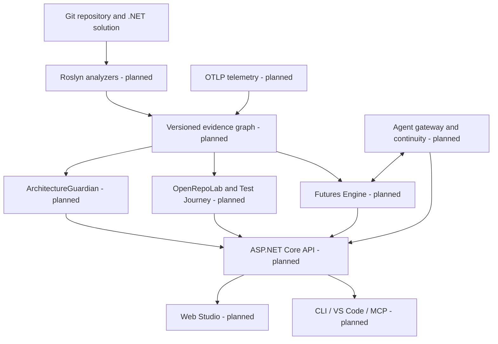

# ArchPulse

**Living Software Engineering & Architectural Futures Platform** · **Status: engineering foundation / under active development** · **License: Apache-2.0**

[العربية](README.ar.md) · [Contribute](CONTRIBUTING.md) · [Governance](GOVERNANCE.md) · [Architecture](docs/architecture/README.md) · [Roadmap](ROADMAP.md) · [Agent handoff](AGENTS.md)

> This is an engineering foundation, **not a working architecture-visualization product**. No claimed live analysis, tracing, agent execution, or visual studio functionality is implemented at this stage. Green badges or feature-completeness claims must not be published before verified CI and acceptance evidence.

## Why ArchPulse?

Repository code, intended design, runtime traces, test results, and AI-agent decisions often tell different stories. ArchPulse is intended to make those differences navigable and explicit. Its planned **local-first .NET engine** will distinguish intended architecture (**designed**) from structure derived from code (**static**), execution evidence (**observed**), AI hypotheses (**inferred**), verified results, and uncertainty (**unknown**). The Web Studio is the primary planned interface; VS Code, CLI/SDK and MCP agents are adapters rather than mandatory engines.

## Planned platform capabilities (not implemented)

| Capability | Intended outcome | Source |
| --- | --- | --- |
| Engineering Knowledge Graph + Roslyn | revision- and evidence-aware structure | S02–S03 |
| Hierarchical Visual Architecture | System → module → service → class → method, multi-lens flow navigation | S27 |
| ArchitectureGuardian | explainable architecture contracts and CI validation | S04, S28 |
| FeatureAtlas + DataJourney | business-feature and privacy-aware data paths | S05–S06 |
| Live Observability | OTLP observations tied to build/commit identity | S08 |
| OpenRepoLab + Test Journey | scoped tests, call/return/exception/assertion journey and replay | S07, S31, S33 |
| Futures Engine / AET | isolated alternatives, fair measurements and human approval | S12 |
| Agent Gateway + Continuity | portable checkpoints, leases, idempotent recovery | S10–S11 |
| Web Studio, VS Code, CLI, MCP Apps | engineer-driven decisions and Mermaid-first fallback | S09, S23, S29–S32 |
| Security and open governance | sandbox, least privilege, maintainership and full-scope release gates | S16–S20 |

## Intended system context



**Evidence contract:** Proposed diagrams do not show verified implementation. Missing telemetry must never be taken as proof that code did not execute. Test cases appear as badges or inspector entries, not as default standalone blocks on the main architecture canvas.

## Foundation source code

The only source project in the foundation bundle is `engine/ArchPulse.Core`, containing a small illustrative **evidence-receipt contract** with tests. It does not implement the Knowledge Graph or any product module. This intentionally avoids empty placeholder projects and simulated features.

```bash
dotnet restore ArchPulse.sln
dotnet build ArchPulse.sln --no-restore -c Release
dotnet test ArchPulse.sln --no-build -c Release
```

Requires .NET 10 SDK. These commands are prescribed but **not verified in the authoring environment**; see [verification report](docs/operations/FOUNDATION-VERIFICATION.md).

## Start contributing

Read [First Contribution](docs/contributing/first-contribution.md), choose a `good first issue` when issues become available, discuss a design-changing proposal using the RFC template, fork the repository, run checks, and open a PR. Ordinary contributions never require organization membership. The maintainer path is described in [Governance](GOVERNANCE.md) and [Maintainers](MAINTAINERS.md).

Full specifications, 205 original tasks and requirement mapping are held in the [Notion master](https://app.notion.com/p/4143830ba34d8153b090c70feab32b62), [specifications database](https://app.notion.com/p/f6a9fd23dace413390e4173038735ac9), [work breakdown](https://app.notion.com/p/5f2c39784dc24174a8989488350dd0fa), and [S26 traceability matrix](https://app.notion.com/p/4143830ba34d8185a0edc83f974c55cd). See [specification index](docs/requirements/specification-index.md). These sources are not evidence that features are implemented. Use GitHub code/commits/CI for actual delivery status.

## License and brand

Apache License, Version 2.0, SPDX `Apache-2.0`, in [LICENSE](LICENSE). This does not grant trademark rights. The name ArchPulse is not claimed globally unique. No external third-party assets are shipped in this foundation bundle.