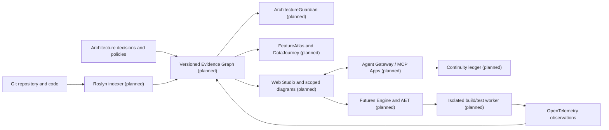

# ArchPulse architecture — designed, not yet implemented

ArchPulse is a proposed **local-first modular monolith in .NET**, with a vendor-neutral public API, a Web Studio, adapters for IDEs/CLI/MCP agents and **isolated workers** for executing untrusted code. The architecture below is a **design concept** (S00/S01), not an extract from running source code.

### Text-only alternative for the proposed architecture diagram

The repository and solution flow into the proposed Roslyn indexer, which
generates a versioned evidence graph. Architecture decisions and policies and
OpenTelemetry traces are additional **intended** graph inputs. The proposed
graph serves Guardian, FeatureAtlas/DataJourney, and Web Studio. Web Studio
connects bidirectionally to the Agent Gateway/MCP Apps, which connects to the
Continuity ledger; Web Studio also initiates Futures Engine experiments in an
isolated worker. The worker supplies proposed OpenTelemetry observations to
the graph. The arrows specify **design dependencies**, not deployed or
verified network integrations; a non-visual reader should not infer that a
source analyzer or worker already implements this full path.

## Evidence classification

| Category | Meaning | Source |
|---|---|---|
| Proposed / Designed | an intended contract, not observed runtime behavior | human-approved architecture record |
| Static | structure derived from a particular code revision | code, Roslyn, commit |
| Observed | a particular execution trace or measurement | runner, trace, revision |
| Inferred | hypothesis or AI suggestion requiring evaluation | inference plus inputs |
| Verified | claim with recorded source/revision and independent validation | reproducible receipts |
| Unknown | insufficient evidence, interruption or uncertain outcome | explicit unknown record |

**Current implementation (partial):** ArchPulse.Core.EvidenceReceipt provides baseline receipt checks; ArchPulse.Graph and ArchPulse.Roslyn can index selected C# structures and persist revision-scoped static graph evidence. The local API and Web Studio can inspect bounded, source-backed slices, including static test links and partial DataJourney. None is an end-to-end architecture evidence authority, authenticated remote runtime or production-grade source of truth. See the [current implementation overview](../../README.md) and its exact-revision CI evidence.

## Bounded contexts

- [Graph + provenance](graph.md) and [Roslyn](roslyn.md)
- [Hierarchical navigation](navigation.md) and [visual annotations](annotations.md)
- [Guardian](guardian.md) and [visual governance](governance.md)
- [FeatureAtlas and DataJourney](feature-data.md)
- [RepoLab](repolab.md) and [Test Execution Journey](test-journey.md)
- [Live observability](live-runtime.md)
- [Futures Engine](futures.md)
- [MCP / bidirectional canvas](mcp-canvas.md) and [Mermaid contract](mermaid-contract.md)
- [Cross-agent continuity](continuity.md)
- [API and clients](api-clients.md)
- [Security](security-model.md), [quality](quality-strategy.md), [deployment](deployment.md)

Every independent module must have owner, contracts, tests and a clear source-of-truth reference before implementation. No premature microservice split without approved ADR.

See the [34 specifications](../requirements/specification-index.md) and [205 tasks](../requirements/task-registry.md).
