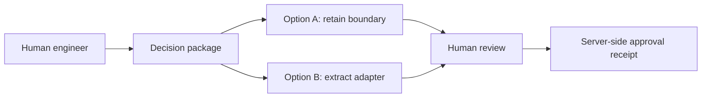

# Mermaid-first engineering diagrams (S32)

**Status: specified, not implemented.** Every proposed architectural alternative must have a non-empty, valid Mermaid diagram even when an MCP host cannot render interactive MCP Apps. Each option must identify its provenance and semantic status `ProposedConcept`, `DerivedFromCode`, `ObservedTrace` or `VerifiedExperiment`.

## Proposed option envelope

```json
{
  "optionId": "Option-A",
  "status": "ProposedConcept",
  "diagramType": "flowchart",
  "diagramSource": "flowchart LR; A[Boundary A] --> B[Boundary B]",
  "sourceGraphRevision": null,
  "assumptionRefs": [],
  "evidenceRefs": []
}
```

## Conceptual example



The example is an **illustrative proposal**, not a real approved decision. Validate Mermaid syntax, safe escaping, payload complexity budgets and source-to-node mapping. Text-only hosts must receive source text and references, not false claims of interaction. Mandatory future acceptance: MD-01..MD-10.
