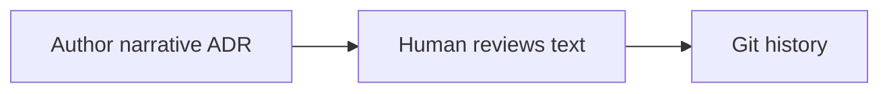
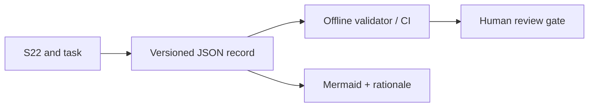

# ADR-0011 — Machine-readable decision records with human review receipts

**Status: Proposed (not Accepted)**  
**Source:** [S22](https://app.notion.com/p/4143830ba34d81a68732f75f600f214c), [T003 / Issue #7](https://github.com/ameenalqershi/ArchPulse/issues/7)  
**Approval:** None; a reviewer must inspect and explicitly decide the exact revision.  
**Impacted scope:** `docs/decisions` and repository documentation validation, *not shipped product modules*.

## Context

The foundation has a human-friendly ADR template, but a free-form description cannot be checked reliably for source traceability, revision-specific human approval, or the successor of a superseded choice. An agent or contributor must not infer adoption from a proposed Notion page.

## Alternative A — Markdown-only ADRs

**Evidence:** The pre-existing `docs/decisions/ADR-template.md` and S22 define human-readable decisions.  
**Benefits:** Almost zero authoring overhead and broad contributor accessibility.  
**Costs:** Automated tools cannot reliably determine whether evidence, status, approval or successor references are complete; manual audits required.

## Alternative B — JSON receipt plus Markdown narrative

**Evidence:** S22 requires explicit alternatives, review receipts, migration and rollback; JSON Schema plus stdlib checks can validate structure offline.  
**Benefits:** Offline reproducibility, stable status indexing and auditable missing-gate failures.  
**Costs:** Extra authoring, risk of duplicated diagrams, and automated validation cannot prove a human decision actually occurred.

## Proposed direction, not a decision

Prefer B as a candidate provided we check the same diagram text in JSON and Markdown and retain a human review gate. The alternative remains open for revision; **no selection has been accepted**.

## Migration and rollback

Existing Markdown-only Proposed documents remain proposals and must not be auto-accepted. Add JSON records incrementally only after coordination with each proposal owner. To roll back governance tooling, revert the PR and keep all original Markdown/Git review history; do not delete accepted decision evidence.

## Unresolved review questions

Who is an eligible human architecture approver? How do we independently verify authority for a historic review if GitHub permissions change? How should we handle a future full Mermaid renderer without a paid service? Document final answers and an explicit GitHub review receipt before Accepted.

## Verification scope

The v1 validator proves structure and offline negative-case rejections only. It does not prove product features, security of untrusted execution, independent agent recovery or the authority of any future reviewer.
