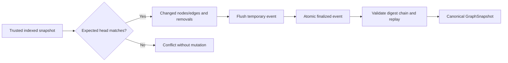
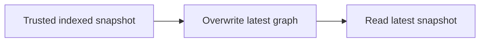

# ADR-0015 — Graph revision delta journal and replay

- Status: Proposed
- Date: 2026-11-14
- Scope: S02/T010 (depends on T009)
- Approval: Human architecture and durability review pending

## Context and invariants

GraphSnapshotStore already provides immutable, exact-revision JSON documents
consumed by read-only APIs, CLI and the Studio. It does not provide
optimistic head concurrency, ordered delta history or replay from committed
change events. Existing graph and evidence contracts must not be broken.
A power-loss guarantee or authenticated evidence cannot be inferred from
a successful local test.

## Option A — Dedicated append-only local event journal (implemented experimentally)

Strengths: additive to existing consumers, deterministic revision evidence,
process-crash retry behavior, explicit CAS, testable history integrity.
Costs: O(history) replay on every append, per-revision JSON metadata, local
writer lock and no cryptographically authenticated external audit.

## Option B — Always rewrite entire mutable latest graph file

Cheaper single read, but loses ordered provenance deltas and predecessor
validation and complicates recovery after torn/incomplete writes. Does not
meet T010's event/replay contract without a separate audit history.

## Proposed decision and human approval

Explore option A locally, using existing immutable snapshots and a separate
trusted CLI journal. **Not an approved S02 architecture decision**;
evaluate checkpoint/compaction, fsync directory semantics, trusted identity
and storage attack model before production or remote activation.

## Migration, rollback and acceptance

No migration: existing snapshot JSON, API and MCP are unchanged.
Revert this additive CLI command/class to roll back. Tests must verify
replay equivalence after process interruption, failed CAS, duplicate
retry, corruption and concurrent writers. Further milestones need load
testing, durable checkpoints, read-side incremental projection and
S11/S16 security approval.
