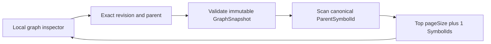
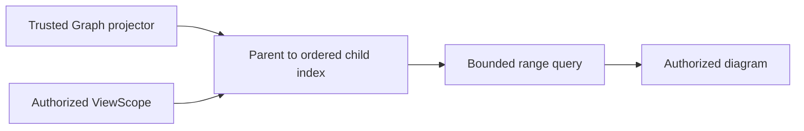

# ADR-0016 — Canonical hierarchy children query on immutable GraphSnapshot

- Status: Proposed
- Date: 2026-11-14
- Scope: T011, partial T119/T121; S02/S27
- Approval: Human architecture, API compatibility and performance review pending

## Context and invariants

GraphSnapshot already has canonical single-parent ownership. Call, dataflow
and feature edges cannot substitute for that ownership. Web Studio needs an
exact-revision, bounded, deterministic traversal starting at roots. Existing
Graph and local API consumers must continue to work unchanged.

## Alternative A — Additive scan-and-select children page (experimental)

This is easy to verify, avoids storing redundant parent indexes, and returns
source-backed nodes in a deterministic order. It still scans/loads all graph
nodes and requires future permission-scoped filtering.

## Alternative B — Persist a canonical child index for ViewScope

This improves repeated query performance and can integrate ViewScope, but
requires approval of schema/revision consistency, update transactions,
invalidations and tenant authorization. No such index is implemented here.

## Proposed decision and acceptance

Introduce option A as **additive local-only prototype**; do not claim production
scale or deploy publicly. Before accepting S27/T121, validate an authorized
ViewScope and the query budget/index approach (possibly B), including
cross-scope portal evidence, stable cursor identity, retries, hierarchy
mutations and load tests. Rollback by reverting this additive method,
contract and route; existing `neighbors-page` remains unchanged.
