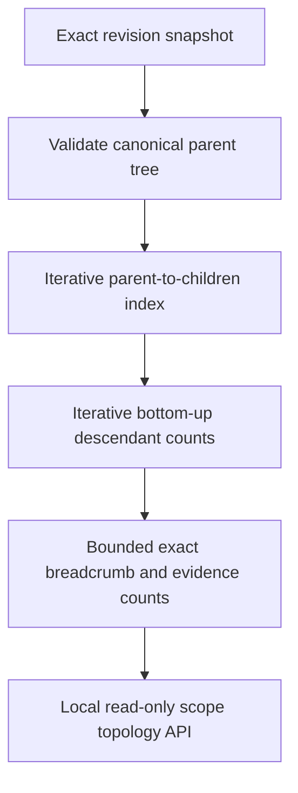
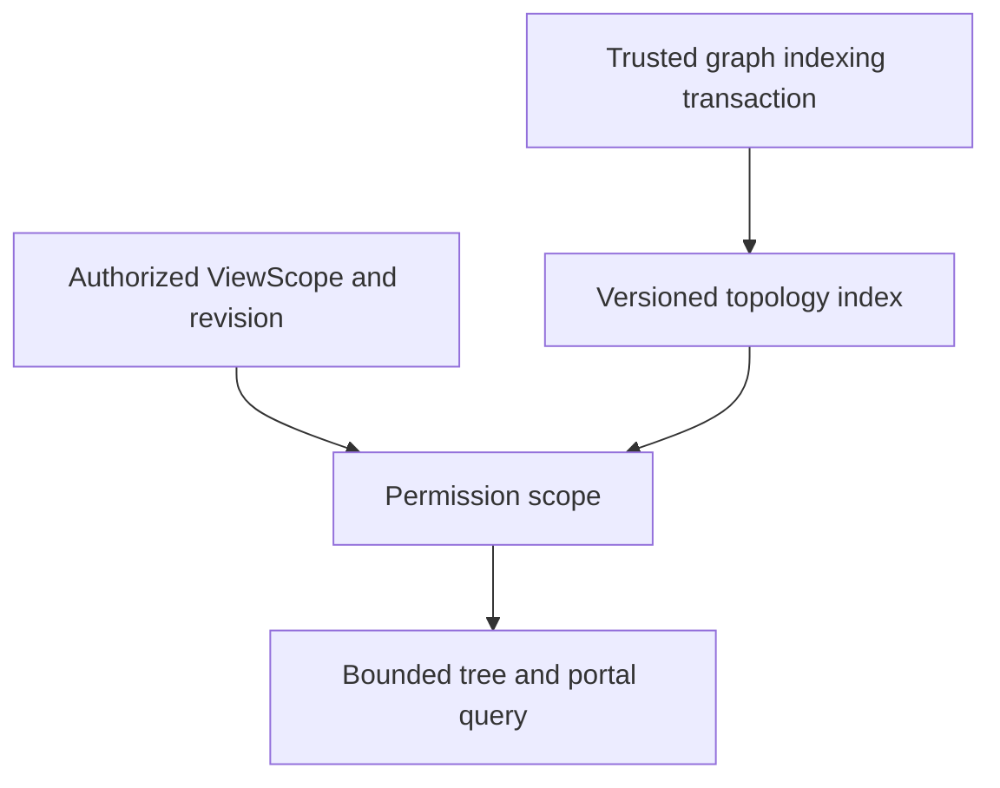

# ADR-0017 — Canonical scope topology projection

- Status: Proposed
- Date: 2026-11-15
- Scope: S27/T119; depends on partial S02/T009/T011
- Approval: Human architecture and query scaling review pending

## Context

Canonical ownership lives in `GraphNode.ParentSymbolId`. The existing
`ChildrenPage` (PR #76) can enumerate direct children but does not return
an exact root-to-leaf path, depth, descendant count or evidence-mode
distribution. S27 needs these facts without conflating call/dataflow edges
with true ownership or claiming inferred evidence is verified.

The prerequisite tasks T009 and T011 have partial implementations but have
not passed full S02 acceptance. This ADR **explicitly bounds the new work
to an opt-in local read-only prototype**; it does not approve T119 production
implementation or alter task dependency gates.

## Alternative A — Rebuild validated in-memory topology on read (implemented)

Advantages: revision-isolated, stateless reads, simple rollback, no extra
persistence contract, no cross-revision stale index. Costs: O(graph) read,
validation and topology allocation for each request; no auth or view budget
across repeated requests.

## Alternative B — Persist a revision-scoped authorized topology index

Better throughput and authorization boundaries, but requires acceptance
of T009 event/index consistency, T121 budget and ViewScope, T120 portals,
migration and a storage security review. Not implemented in this PR.

## Recovery and acceptance

No modification to existing graph snapshots, incremental journal, MCP
endpoints or Studio is needed. Roll back the additive class, endpoint, tests
and guides. Preserve original evidence kind and exact revision on every
node in breadcrumbs. The bounded-breadcrumb read fails closed on excessive
depth rather than claiming complete topology.

Human review and integrated L0–L6 sample repository, advanced node kinds,
100k+/millions-edge benchmark, authorization and UI work are still required
before T119/S27 can be marked Verified/Approved.
