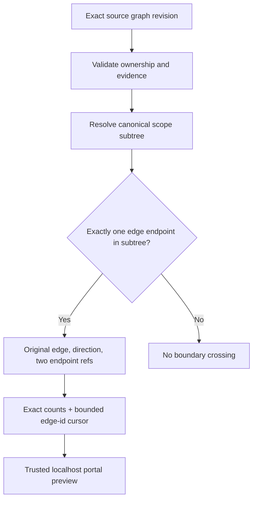
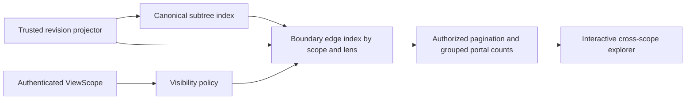

# ADR-0018 — Source-backed cross-scope boundary portals

- Status: Proposed
- Date: 2026-11-15
- Scope: partial T120/S27, depends on T119 and T012
- Approval: pending human architecture, provenance and access review

## Problem

A diagram of a module must show edges that cross its canonical ownership
boundary without copying external service nodes into the module. Calls,
dependency edges and future multi-membership feature relations are not
`ParentSymbolId` and must not create additional canonical owners.
T119 implemented bounded local topology but its full acceptance is open;
T012 provenance integrity remains partial. This is an **independent local
read-only experiment only**, not authorization or dependency approval.

## Alternative A — Reconstruct crossing edge projection on one exact snapshot

Advantages: simple exact revision consistency, no synthetic edges,
testable cursor, explicit evidence/status fields, no additional storage.
Limits: O(nodes+edges) scan per request, trusted local only, no access
filter, no feature-context membership, no aggregation across scopes.

## Alternative B — Versioned authorized portal index (not implemented)

This avoids repeated full-graph scans but requires T012 source proof,
T119 stable topology, T121 authorized ViewScope/filtering and T122
aggregation semantics. It needs explicit policy for counts, endpoint
previews, caching and deletion to prevent cross-tenant inference.
None of those decisions are approved here.

## Outcome and rollback

Implement only A as an additive local Graph class + GET endpoint.
Keep `AuthorizationNotEvaluated` and `NotIndexed` status explicit, reject
unsafe page sizes or scan budgets, and preserve every returned
source evidence ref. Remove the additive code/routes to roll back.
S27 remains Proposed and T120 remains In Progress until all S27
authorization, membership, UI, performance and acceptance tests exist.
