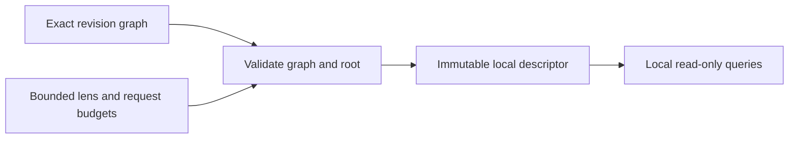
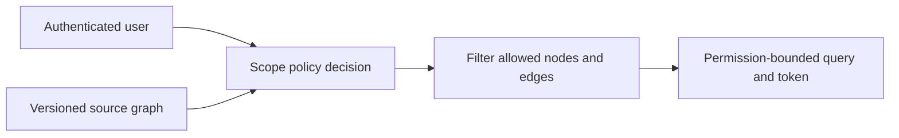

# ADR-0019 — Local exact-revision ViewScope descriptor

- Status: Proposed
- Date: 2026-11-16
- Task: T121/S27 partial experimental slice
- Dependency gate: T119, T011 and T047 are not fully accepted.

## Decision candidates

### A. Validated local selection (this prototype)

This pins source revision, exact root SymbolId, lens and bounded query
selection. AccessStatus is always AuthorizationNotEvaluated; it is NOT a
permission token, not a data-leak safeguard, and cannot substitute for
authorization.

### B. Authorized permission-filtered ViewScope (future)

Needs an accepted T047 policy, scope security review, tenancy boundaries,
redaction before graph traversal, signed cursor strategy and integrated
evidence. Not implemented or approved.

## Bounds and next gates

The local prototype supports six exact lenses, maxNodes 1–1000,
maxEdges 1–2000, depth 0–8, and exact root membership. These are
request descriptors only, not enforced traversal budgets. No production
permissions, cursor signatures, authenticated API, Web Studio navigation,
or performance guarantee is claimed. Human review required.
