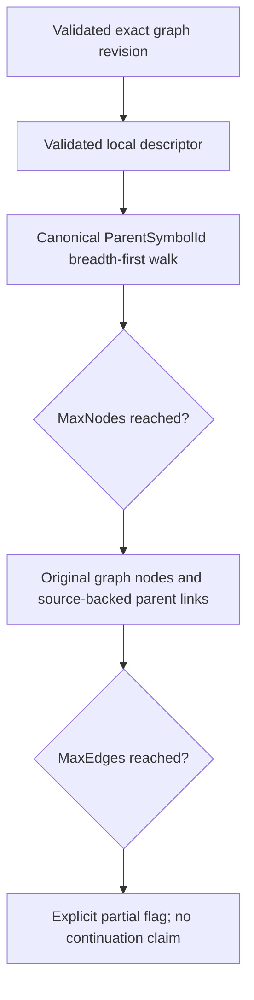
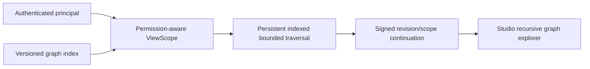

# ADR-0020 — Bounded canonical scope expansion (Proposed)

- Date: 2026-11-16
- Scope: T121/S27 partial, local-only; T047 approval remains pending
- Status: Proposed; human architecture review required

## Alternative A — Exact-revision bounded breadth-first canonical expansion

Implemented as `BoundedCanonicalExpansion.Execute`: preserves the source-backed
identity of returned graph nodes; canonical parent links are labeled with
their original child evidence. At most maxNodes nodes, maxEdges parent links,
with bounded pending queue. Only canonical ownership (not Calls, features,
dataflow or runtime) is represented; `depth` is bounded by the descriptor.
No external client, production authorization or pagination is granted.

## Alternative B — Authorized persisted graph expansion and continuation

Not implemented. Requires accepted T047 access policy, audited permission
filters, T119 topology and T120 boundary portals, exact signed continuation,
security tests, performance targets and human approval.

## Known constraints

The local prototype still loads and validates the whole GraphSnapshot and
builds an in-memory parent index, so total I/O and indexing work are not
bounded by the page budgets. The `NoContinuationAvailable` status means a
partial result cannot claim a resumable continuation. Lens selection is
recorded, not enforced into a complete lens-specific graph query. All access
is explicitly `AuthorizationNotEvaluated` and production exposure is barred.
Task T121 is *In Progress*, not Verified, regardless of CI success.
