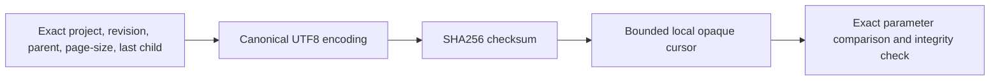
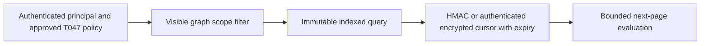

# ADR-0021 — Revision-bound local child cursor (Proposed)

Date: 2026-11-16. T121/S27 partial experimental local contract; T047 and actual signed continuation are not approved.

## Alternative A — Revision/scope-bound checksum token (implemented)

Deterministic checksum detects accidental mixing of child page requests across exact revisions, parents, projects and page sizes. Rejects noncanonical encoding, tampered/oversize tokens. The checksum is unkeyed and **not** a security signature; clients can generate valid checksums, so no claim of tamper resistance, authentication, authorization or confidentiality is permitted. Cursor is not yet wired to the API and is a separate local primitive only.

## Alternative B — Authorized signed continuation (not implemented)

This alternative needs authenticated identity, per-tenant redaction before counting, key rotation, bounded index I/O and legal human approval. Keep S27 and T121 In Progress; ADR-0021 Proposed.
