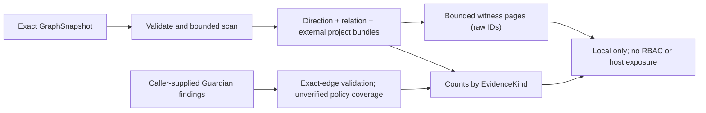
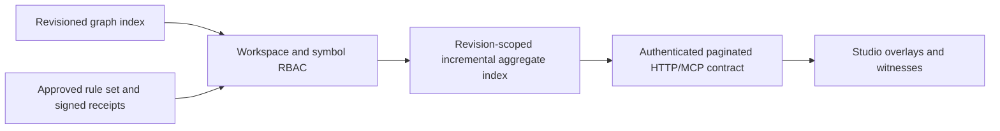

# ADR-0022 — Experimental local, loss-aware cross-scope edge aggregation

- Status: **Proposed** — requires human architectural review; not an approved policy.
- Date: 2026-11-16
- Scope: S27/T122; graph-to-Guardian read-only composition.
- Requirement: R-NAV-014. Preserve exact provenance, counts, and highlighted high-severity findings when hundreds of calls are collapsed; provide source-backed witness drilldown.

## Alternative A — Local evidence-preserving grouping (proposed implementation)

Advantage: additive, no new Graph->Guardian dependency, tests can prove counts and source identity. Tradeoff: in-memory bounded-edge scan of already-loaded graph and no authorization, persisted summaries, or signed cursors.

## Alternative B — Authorized incremental server projection (future design only)

Advantage: shared, permission-filtered summaries and bounded reuse. Tradeoff: requires accepted S01/T002/T047 authorization, versioned policy lifecycle and safe invalidation; pretending those exist today would be unsafe.

## Decision boundary and acceptance

Implement only Alternative A as a **review candidate**, retain `NotEvaluated`/unverified states, leave S27, T122, T047 and this ADR unapproved. Future work: external policy authority, redaction, integrated API/Studio tests, 100k/1m performance measurements, all exact dependent tasks accepted. No claim that an empty findings list means no violation.
