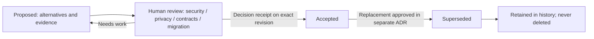

# Architecture decision lifecycle — T003 / S22

Status: **Proposed governance contract; not an approved architecture decision**. Source: [S22](https://app.notion.com/p/4143830ba34d81a68732f75f600f214c) and [T003](https://app.notion.com/p/4143830ba34d81888c56d135862b55aa).

## When an ADR is required

Open a numbered ADR for a cross-module or hard-to-reverse choice, public API/protocol, persistence format, untrusted execution boundary, authorization/data privacy, or a change to an existing Accepted decision. A chat message, issue assignment, green CI run, or AI recommendation **never** approves an ADR.

## Lifecycle



- **Proposed**: author records context, >=2 alternatives, a Mermaid diagram for each, tradeoffs, URLs for evidence, affected modules, migration/rollback, the source Sxx/Txxx and outstanding review gates. No approved decision or implementation claim.
- **Accepted**: a human reviewer posts an explicit approval through an authenticated GitHub PR review, naming the exact content commit and decision. Store the review URL, reviewer's GitHub login, commit SHA, date and the reviewing human in the structured record. All required evidence gates must be satisfied. Status changes in a separately reviewed PR. CI validates *shape*, not reviewer identity, permission or actual authorization.
- **Superseded**: only a previously Accepted ADR may transition to Superseded, referencing a *different Accepted* successor, with another human-reviewed change receipt. Keep old files and the decision history; do not silently rewrite rationale. A replacement cannot supersede itself or form cycles.
- **Rejected/withdrawn proposal**: close the proposal PR with explanation; keep GitHub history. v1 deliberately has no Rejected status. Do not mislabel a rejection as Superseded.

## Record contract and compatibility

The machine-readable source is `docs/decisions/records/ADR-NNNN.json` using [adr-v1.schema.json](adr-v1.schema.json). Its `document` references the readable Markdown ADR, and `alternatives[].mermaid` must be identical to a fenced Mermaid diagram in that Markdown. `tooling/ArchPulse.RepositoryValidator/AdrChecker.cs` checks record structure, task links, lifecycle constraints, receipt syntax and Mermaid narrative consistency offline with .NET. The JSON Schema remains available to external tooling. The validator never authenticates actual GitHub reviews.

Older Markdown-only proposals, such as a proposed ADR-0001 in T002, remain **unapproved proposals**. They are not automatically migrated, approved, or silently renumbered. Before an older proposal may be accepted, supply a conforming record and complete the human review; coordinate filenames with its owner.

## Review checklist and proof

1. Discuss alternatives, links to source evidence and diagram renderings; identify impacted components and API contracts.
2. If the proposal introduces a new execution path, require a threat model and security review. If new data sources/PII, require privacy review. If protocol or persistence changes, require compatibility and migration evidence. The `gates` flags specify which reviews are applicable; evidence URLs are mandatory for flagged gates when Accepted.
3. Require a version-specific test plan, failure/rollback strategy, and CI proof for any implemented change. Prospective designs need not fabricate measurements or runnable services.
4. A human with actual repository review authority evaluates the exact diff. A machine-valid `approval` value is **not proof** of that authority: verify review provenance and reviewer permissions manually on GitHub.
5. Once Accepted, an implementation PR cites ADR ID, exact approved revision, dependency status, CI links, and migration outcome; do not mark Notion tasks Verified based only on a proposed ADR.

## Agent recovery procedure

An independent agent reads S22, the ADR JSON schema and records, and executes
the native validators in an authorized trusted checkout:

```bash
dotnet restore ArchPulse.sln --locked-mode
dotnet build ArchPulse.sln -c Release --no-restore
dotnet run --project tooling/ArchPulse.RepositoryValidator -c Release --no-build -- --root . --adr
dotnet test tooling/ArchPulse.Tooling.Tests/ArchPulse.Tooling.Tests.csproj -c Release --no-build --filter FullyQualifiedName~AdrValidationTests
dotnet run --project tooling/ArchPulse.TraceabilityValidator -c Release --no-build -- --root .
```

The receiver independently verifies source SHA, ADR status, human approvals
and hosted CI on that exact revision. Contract checks alone do not prove a
reviewer authorized a decision or cross-agent takeover succeeded.

## Known limitations

The native C# validator checks Mermaid block presence, approved diagram prefixes and exact JSON/Markdown matches; it is **not a full Mermaid grammar parser**, renderer or semantic proof. Rendering and security judgment remain human review responsibilities. CI's approval receipt checks syntax and links, not authenticity or the reviewer's identity. A transition audit must additionally compare Git history; `validate_adr.py` only validates a snapshot.
