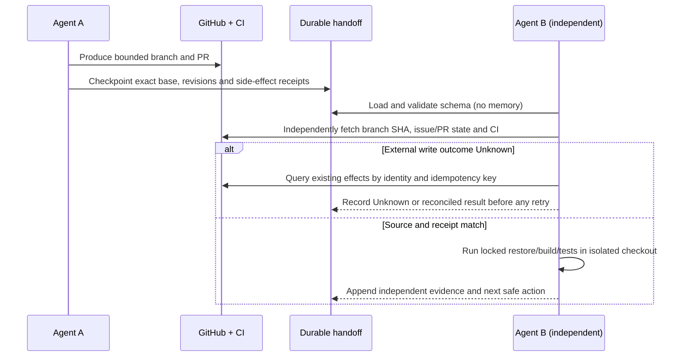

# Safe S25 development-agent handoff rehearsal

**Scope:** workflows that build ArchPulse, not the future user-facing S11 continuation engine.
**Canonical spec:** [Notion S25](https://app.notion.com/p/4143830ba34d81f3a119d6a5f7c01ae4).
**Tracking:** [T117 / #13](https://github.com/ameenalqershi/ArchPulse/issues/13) and [T118 / #14](https://github.com/ameenalqershi/ArchPulse/issues/14).
The test below is **not** a completed real second-agent rehearsal until a separate agent, without chat history, records an independent report.

## Protocol

## Agent A — before transfer

1. Ensure one isolated branch/worktree per task. Capture `git rev-parse HEAD`, `git status --porcelain=v1`, repo URL, Txxx/Sxx, dependencies and exact CI run URL.
2. Use an immutable `docs/operations/agent-handoff/<task>-<date>.json` document with the required v1 fields. Classify unconfirmed external effects as `unknown`, not `succeeded`. Use a stable `idempotencyKey` per logical action, not per attempt.
3. Record tests as exit code + exact SHA + environment; do not claim GitHub CI success merely from local tests.
4. Run `dotnet run --project tooling/ArchPulse.RepositoryValidator -- --root . --handoffs` and `dotnet test tooling/ArchPulse.Tooling.Tests/ArchPulse.Tooling.Tests.csproj` before publishing. The validator detects structural errors and common credential patterns; it does **not** authenticate claims.

## Agent B — new context, no conversation history

1. Open `AGENTS.md`, the Notion Txxx/Sxx, and the checkpoint. Run `dotnet run --project tooling/ArchPulse.RepositoryValidator -- --root . --handoffs` against the checkout. **Do not inherit Agent A's tool access or approvals.**
2. Independently query `git ls-remote origin refs/heads/main`, `git rev-parse HEAD`, the task issue, PR state, commits and checks, and inspect source changes. A stale checkpoint is historical evidence, not an instruction to force a ref.
3. If `create-issue`, `create-pr`, comment or permission change has `unknown` outcome, search GitHub by task identifier, branch, URL and idempotency marker **before** attempting the same effect. Never retry a non-idempotent write while the outcome remains unknown.
4. In a clean isolated checkout run `dotnet restore ArchPulse.sln --locked-mode`, `dotnet build ArchPulse.sln -c Release --no-restore`, `dotnet test ArchPulse.sln -c Release --no-build`, and all native ADR, requirements-baseline, handoff and xUnit contract validators.
5. Write a **separate receiver report** showing checkpoint SHA versus actual branch/CI SHA, task/Notion consistency, discrepancies, unknowns, test logs and exact next safe action. Send it to #14 with URLs or a reviewable PR; do not classify T118 as Verified without this independent run.

## Limits and format compatibility

The Notion S25 example uses a conceptual marker `archpulse.dev-handoff.v1` while the current repository publishes `archpulse-agent-handoff/v1`; they are **not byte-compatible schemas**. This repository validator explicitly targets the checked-in repository v1; changing the public envelope needs a reviewed migration or ADR, not a silent schema rename. Older `externalEffects` entries may be descriptive strings; newer structured entries should include `action`, stable `idempotencyKey`, `state` and `receipt`.

The validator cannot prove whether any GitHub PR was merged, whether a claim is authentic, or whether a secret escaped a non-matching signature. External state must be reconciled independently. **No cloud-agent costs, product API keys or production sandbox required for this foundation rehearsal preparation.**
